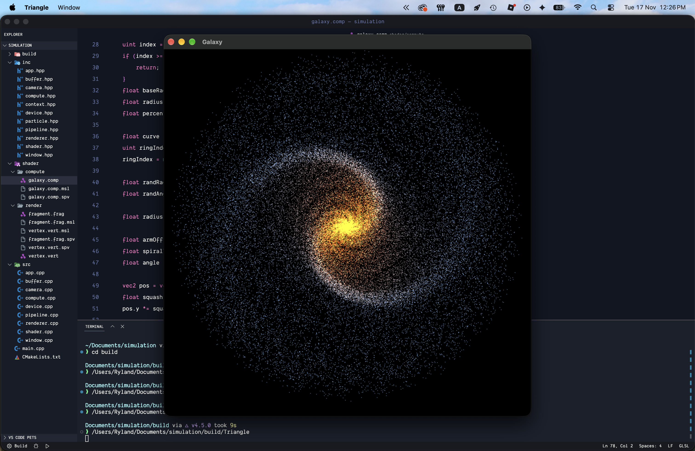

# Galaxy-SDL_GPU-ComputeShader

A render of a galaxy using SDLGPU and C++. Runs using Compute Shaders and uses the Density Wave theory.

Source of Density Wave Theory: https://beltoforion.de/en/spiral_galaxy_renderer/

